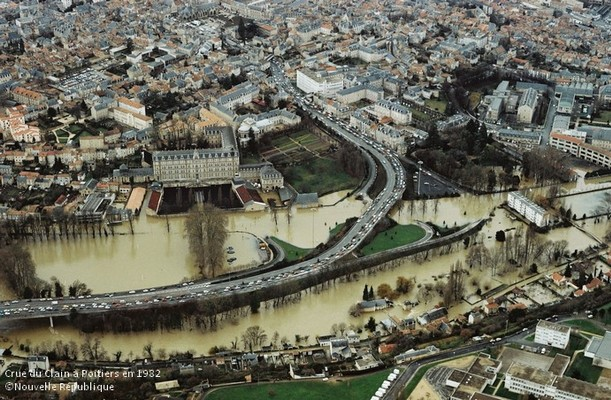
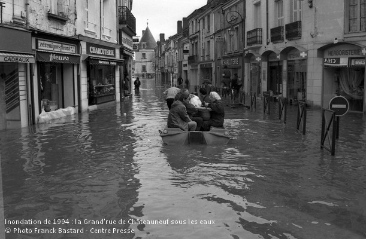
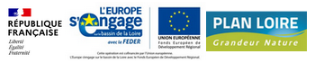

```{=html}
<!-- ============ BANDEAU ============ -->
<section class="hero">
  <i class="bi bi-droplet-fill goutte"></i>
  <i class="bi bi-droplet-fill goutte"></i>
  <i class="bi bi-droplet-fill goutte"></i>
  <i class="bi bi-droplet-fill goutte"></i>

  <h1>Observatoire de la vulnérabilité<br>aux inondations</h1>
  <p class="sous-titre">Bassins de la Vienne et du Clain : mieux savoir pour mieux agir.</p>
  <div class="badge-cle">
    <i class="bi bi-water"></i>
    Crue centennale : <strong>1 chance sur 100</strong> de se produire chaque année
  </div>

  <div class="vagues">
    <svg viewBox="0 0 1200 90" preserveAspectRatio="none">
      <path fill="#fff" d="M0 45 Q150 0 300 45 T600 45 T900 45 T1200 45 V90 H0Z"/>
    </svg>
    <svg viewBox="0 0 1200 90" preserveAspectRatio="none">
      <path fill="#fff" d="M0 55 Q150 15 300 55 T600 55 T900 55 T1200 55 V90 H0Z"/>
    </svg>
  </div>
</section>

<style>
:root {
  --acc-bleu: #0a6ebd;
  --acc-bleu-fonce: #08406e;
  --acc-cyan: #38bdf8;
  --acc-texte: #1e293b;
  --acc-doux: #f1f5f9;
}

/* ---------- Bandeau ---------- */
.hero {
  position: relative; overflow: hidden;
  margin: 10px 0 40px; padding: 70px 40px 110px;
  border-radius: 24px; color: #fff; text-align: center;
  background: linear-gradient(135deg, var(--acc-bleu-fonce), var(--acc-bleu) 60%, #1b8fd6);
  box-shadow: 0 20px 50px rgba(8, 64, 110, .3);
}
.hero h1 {
  margin: 0 0 12px; font: 800 clamp(1.8rem, 4vw, 3rem)/1.15 system-ui, "Segoe UI", sans-serif;
  color: #fff; border: 0;
}
.hero p.sous-titre {
  max-width: 640px; margin: 0 auto 28px;
  font-size: clamp(1rem, 2vw, 1.2rem); opacity: .92;
}
.hero .badge-cle {
  display: inline-flex; align-items: center; gap: 10px;
  padding: 10px 20px; border-radius: 999px;
  background: rgba(255,255,255,.15); backdrop-filter: blur(6px);
  border: 1px solid rgba(255,255,255,.35); font-weight: 600;
}
.hero .badge-cle strong { font-size: 1.3em; color: #fde68a; }

/* Vagues */
.vagues { position: absolute; left: 0; bottom: 0; width: 100%; height: 90px; overflow: hidden; }
.vagues svg {
  position: absolute; bottom: 0; left: 0; width: 200%; height: 100%;
  animation: houle 12s linear infinite;
}
.vagues svg:nth-child(2) { opacity: .5; animation-duration: 20s; animation-direction: reverse; }
@keyframes houle { to { transform: translateX(-50%); } }

/* Gouttes flottantes */
.goutte {
  position: absolute; color: rgba(255,255,255,.22);
  animation: flotte 6s ease-in-out infinite;
}
.goutte:nth-of-type(1) { top: 18%; left: 8%;  font-size: 2.2rem; }
.goutte:nth-of-type(2) { top: 55%; left: 16%; font-size: 1.4rem; animation-delay: -2s; }
.goutte:nth-of-type(3) { top: 22%; right: 10%; font-size: 2.6rem; animation-delay: -4s; }
.goutte:nth-of-type(4) { top: 60%; right: 18%; font-size: 1.6rem; animation-delay: -1s; }
@keyframes flotte { 50% { transform: translateY(-14px); } }

/* ---------- Sections ---------- */
.section-titre {
  display: flex; align-items: center; gap: 14px; margin: 50px 0 18px;
  font: 700 1.7rem system-ui, "Segoe UI", sans-serif; color: var(--acc-bleu-fonce);
}
.section-titre i {
  display: grid; place-items: center; width: 46px; height: 46px; border-radius: 14px;
  background: linear-gradient(135deg, var(--acc-cyan), var(--acc-bleu)); color: #fff; font-size: 1.3rem;
}
.texte { font-size: 1.1rem; line-height: 1.7; color: var(--acc-texte); text-align: justify; }
</style>
```

```{=html}
<style>
.style-h2{
font-family: 'Lora', 'Georgia', serif;
}

.avec-icone > h2::before {
  font-family: "Font Awesome 5 Free";
  font-weight: 900;
  content: "\f059";        /* code de l'icône */
  margin-right: .6rem;
  color: var(--mode-main); /* suit la couleur du switch */
}
</style>
```

## Pourquoi un observatoire ? {.style-h2 .avec-icone}

```{=html}
<div style="text-align:justify; font-size:18px; font-family:'Inter', system-ui, -apple-system, BlinkMacSystemFont, 'Segoe UI', Roboto, sans-serif;">
L’inondation est le premier risque naturel en France, il menace des vies, des habitations, des emplois. Bien qu’épargnés ces dernières années, les bassins de la Vienne et du Clain ont connu des inondations par le passé et les évènements récents sur des territoires voisins incitent à une prise de conscience de la population.<br> La gestion du risque inondation dépend de la vulnérabilité du territoire qui se traduit ici comme la propension pour des personnes, des biens et des activités à être affectés par ce phénomène. Appréhender les différentes vulnérabilités est une composante essentielle du défi «Mieux savoir pour mieux agir» identifié au niveau national.
<br>
Partager cette connaissance avec le plus grand nombre est le principal objectif de cet observatoire.
<br><br> 
</div>
```

```{=html}
<div>
  <div id="photos_crues">
    
    
  </div>
</div>
<br/><br/>
```

```{=html}
<style>
.avec-icone2 > h2::before {
  font-family: "Font Awesome 5 Free";
  font-weight: 900;
  content: "\f201";        /* code de l'icône */
  margin-right: .6rem;
  color: var(--mode-main); /* suit la couleur du switch */
}
</style>
```

## Des indicateurs pour connaître la vulnérabilité {.style-h2 .avec-icone2}

```{=html}
<div style="text-align:justify; font-size:18px; font-family:'Inter', system-ui, -apple-system, BlinkMacSystemFont, 'Segoe UI', Roboto, sans-serif;">

L’observatoire permet la visualisation de plusieurs indicateurs, calculés à partir d’une méthode nationale. Ils s’appuient tous sur une crue dite centennale c’est-à-dire qui a «une chance» sur 100 de se produire tous les ans.<br> Ces indicateurs permettent de décrire la vulnérabilité mais ils peuvent également être utilisés pour évaluer l'efficacité des actions menées sur le terrain qui visent à réduire le risque.<br><br> Ils sont répartis selon 3 objectifs : <br> • Objectif 1 : Augmenter la sécurité des populations exposées, <br> • Objectif 2 : Stabiliser à court terme et réduire à moyen terme le coût des dommages, <br> • Objectif 3 : Raccourcir fortement le délai de retour à la normale des territoires sinistrés. <br> 
</div>

<div style="text-align:justify; font-size:18px; font-family:'Inter', system-ui, -apple-system, BlinkMacSystemFont, 'Segoe UI', Roboto, sans-serif;">
<br>
Les indicateurs ont été actuellement calculés sur le territoire de Grand Poitiers et quelques communes qui jalonnent la Vienne dont Châtellerault. Dans le futur, ils ont vocation à être étendus au périmètre de la stratégie locale de gestion du risque inondation Vienne – Clain.<br> Cet observatoire vous permet de consulter pour chaque indicateur de vulnérabilité un onglet dédié comprenant une carte dynamique, des graphiques et des résultats bruts et une fiche téléchargeable et imprimable avec les éléments de construction de l'indicateur et la carte de vulnérabilité.

</div>
```

<br>

```{=html}
<style>
.avec-icone3 > h2::before {
  font-family: "Font Awesome 5 Free";
  font-weight: 900;
  content: "\f0c0";        /* code de l'icône */
  margin-right: .6rem;
  color: var(--mode-main); /* suit la couleur du switch */
}
</style>
```

## Les auteurs de l’observatoire {.style-h2 .avec-icone3}

```{=html}
<div style="text-align:justify; font-size:18px; font-family:'Inter', system-ui, -apple-system, BlinkMacSystemFont, 'Segoe UI', Roboto, sans-serif;">

 L’observatoire est le fruit d’une collaboration entre l’Etablissement Public Territorial du Bassin (EPTB) de la Vienne et le CEREMA. Plusieurs collectivités et services de l’Etat ont contribué également à son élaboration (Grand Poitiers, Grand Châtellerault, CC. Vienne et Gartempe, Département de la Vienne, DDT de la Vienne, DREAL Nouvelle Aquitaine). Le financement de ce projet s’insère dans un Programme d’Action de Prévention des Inondations (PAPI) financé par l’Etat (Fonds Barnier) et l’Europe (Plan Loire). <br>

</div>

<br> 

<div class="header-flex">
  
  <!-- Contact à gauche -->
  <div class="contact-left">
    <a href="mailto:contact@eptb-vienne.fr" target="_blank">
      <i class="bi bi-envelope" style="color:black;"></i> Nous contacter
    </a>
    <span>(contact@eptb-vienne.fr)</span>
  </div>

  <!-- Logo à droite -->
  

</div>

<style>
.header-flex {
  display: flex;
  justify-content: space-between; /* Contact à gauche, logo à droite */
  align-items: center;
  margin: 20px 0;
  border: 2px solid cadetblue;
  padding: 10px;
  border-radius: 30px;
  background-color: aliceblue;
}

.contact-left {
  text-align: left;
  font-size: 1.05rem;
}

.contact-left a {
  font-weight: 600;
  color: #0a6ebd;
  text-decoration: none;
  margin-right: 6px;
}

.contact-left a:hover {
  text-decoration: underline;
}


/*#quarto-content{
  margin-left:10vw;
  margin-right:10vw;
}*/

@media (max-width:873px){
.header-flex {
 display:block;
 text-align:center;
}

.contact-left {
  text-align: center;
}
}
</style>
```
