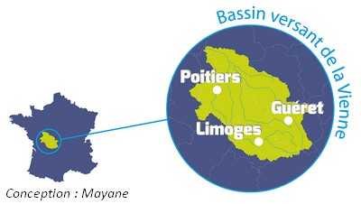
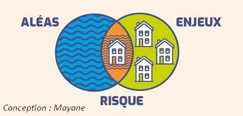
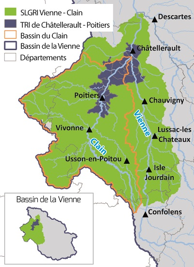

```{=html}
<style>
.style-h2{
font-family: 'Lora', 'Georgia', serif;
}

.avec-icone > h2::before {
  font-family: "Font Awesome 5 Free";
  font-weight: 900;
  content: "\e50e";        /* code de l'icône */
  margin-right: .6rem;
  color: var(--mode-main); /* suit la couleur du switch */
}

.avec-icone-risque > h2::before {
  font-family: "Font Awesome 5 Free";
  font-weight: 900;
  content: "\f740";        
  margin-right: .6rem;
  color: var(--mode-main);
}

.avec-icone-origine > h2::before {
  font-family: "Font Awesome 5 Free";
  font-weight: 900;
  content: "\f689";        /* nuage de fortes pluies */
  margin-right: .6rem;
  color: var(--mode-main);
}

.avec-icone-strategie > h2::before {
  font-family: "Font Awesome 5 Free";
  font-weight: 900;
  content: "\f3ed";        /* bouclier */
  margin-right: .6rem;
  color: var(--mode-main);
}

.avec-icone-observatoire > h2::before {
  font-family: "Font Awesome 5 Free";
  font-weight: 900;
  content: "\f1e5";        /* jumelles */
  margin-right: .6rem;
  color: var(--mode-main);
}
</style>
```
## Pour mieux comprendre les inondations {.style-h2 .avec-icone}


<div style="text-align:justify; font-size:18px; font-family:'Inter', system-ui, -apple-system, BlinkMacSystemFont, 'Segoe UI', Roboto, sans-serif;">
  Le [**bassin versant**]{style="cursor:pointer; color:#42429f;" data-bs-toggle="tooltip" title="Espace qui collecte l'eau s'écoulant à travers les différents milieux aquatiques (cours d'eau, lacs, étangs, milieux humides, estuaires ou lagunes), depuis les sources jusqu'à son exutoire (Source : d’après l’Office International de l’Eau – OIEAU)."} de la Vienne s’étend sur 21 160 km². Marqué par plusieurs crues historiques, comme celles de 1913, 1982 et 1994, ce vaste territoire est sensible aux inondations. Si l’ensemble du bassin est concerné par ce risque, la partie aval reste la plus impactée en raison de sa topographie et des enjeux présents.
  
  <figure style="margin:16px auto 0 auto; text-align:center;">
    
    <figcaption style="font-size:14px; font-style:italic;">Carte du bassin versant de la Vienne</figcaption>
  </figure>

</div>

<br/><br/>

## Qu’est-ce que le risque inondation ? {.style-h2 .avec-icone-risque}

<div style="text-align:justify; font-size:18px; font-family:'Inter', system-ui, -apple-system, BlinkMacSystemFont, 'Segoe UI', Roboto, sans-serif;">

Le risque inondation est le croisement d’un aléa (phénomène potentiellement dangereux) et d’enjeux (tout ce qui peut subir des dommages).
  <figure style="margin:16px auto 0 auto; text-align:center;">
  
  </figure>
</div>

<br/><br/>

## D’où viennent les inondations ? {.style-h2 .avec-icone-origine}

<div style="text-align:justify; font-size:18px; font-family:'Inter', system-ui, -apple-system, BlinkMacSystemFont, 'Segoe UI', Roboto, sans-serif;">

Une inondation peut avoir plusieurs causes : débordement de cours d’eau, ruissellement, remontées de nappes…<br> L’observatoire illustre la vulnérabilité du territoire pour le risque débordements de cours d’eau et ruissellement.<br/>

</div>

<br>

## Quelle stratégie pour réduire le risque ? Quelles actions ? {.style-h2 .avec-icone-strategie}

<p align="justify">

<div style="text-align:justify; font-size:18px; font-family:'Inter', system-ui, -apple-system, BlinkMacSystemFont, 'Segoe UI', Roboto, sans-serif;">
 En France, il existe 124 Territoires à Risque Important (TRI) pour les inondations. Ils représentent des zones où les enjeux potentiellement exposés sont les plus forts et dont les conséquences ont une portée nationale. Le bassin de la Vienne est concerné par le TRI de Châtellerault – Poitiers, il est composé de [**17 communes**]{style="cursor:pointer; color:#42429f;" data-bs-toggle="tooltip" title="Availles-en-Châtellerault, Beaumont Saint-Cyr, Bonneuil-Matours, Buxerolles, Cenon-sur-Vienne, Chasseneuil-du-Poitou, Châtellerault, Dissay, Jaunay-Marigny, Ligugé, Migné-Auxances, Naintré, Poitiers, Saint-Benoît, Saint-Georges-lès-Baillargeaux, Smarves, Vouneuil-sur-Vienne."}.<br/> Dans ces territoires, une Stratégie Locale de Gestion du Risque Inondation (SLGRI) doit être élaborée en concertation avec les acteurs locaux (collectivités territoriales, préfectures, services de secours, gestionnaires de réseaux, usagers, …). La stratégie peut s’étendre à une échelle plus vaste pour garantir notamment une logique de bassin versant. C’est le choix qui a été retenu puisque la stratégie Vienne – Clain s’étend sur près de 250 communes, 5 400 km² depuis la confluence Vienne – Issoire (16) jusqu’à la confluence Vienne – Creuse (37) en y intégrant le bassin du Clain.<br/> La stratégie Vienne – Clain décrit les objectifs et les mesures à prendre pour réduire le risque inondation, elle constitue la « feuille de route » à suivre pour les prochaines années. A l’horizon 2023, la stratégie sera déclinée de manière opérationnelle en plusieurs actions dont les champs d’intervention seront les suivants :<br/>   - Amélioration de la connaissance et de la conscience du risque,<br/>   - Surveillance, prévision des crues et des inondations,<br/>   - Alerte et gestion de crise,<br/>   - Prise en compte du risque d’inondation dans l’urbanisme,<br/>   - Réduction de la vulnérabilité des personnes et des biens,<br/>   - Gestion des écoulements,<br/>   - Gestion des ouvrages de protection hydrauliques.<br/> <br/> Pour en savoir plus sur les actions menées : <a href="http://www.eptb-vienne.fr/-Inondations-.html" target="_blank" >http://www.eptb-vienne.fr/-Inondations-.html</a><br>

</div>

<br/>

## L’observatoire, un outil dynamique {.style-h2 .avec-icone-observatoire}

<div style="text-align:justify; font-size:18px; font-family:'Inter', system-ui, -apple-system, BlinkMacSystemFont, 'Segoe UI', Roboto, sans-serif;">

L’observatoire de la vulnérabilité aux inondations participe à l’amélioration de la connaissance et de la conscience du risque. Actuellement limité à Grand Poitiers et quelques communes qui jalonnent la Vienne dont Châtellerault, cet outil est amené à s’enrichir dans les années à venir notamment pour s’étendre au périmètre Vienne – Clain.<br/><br/>

</div>
